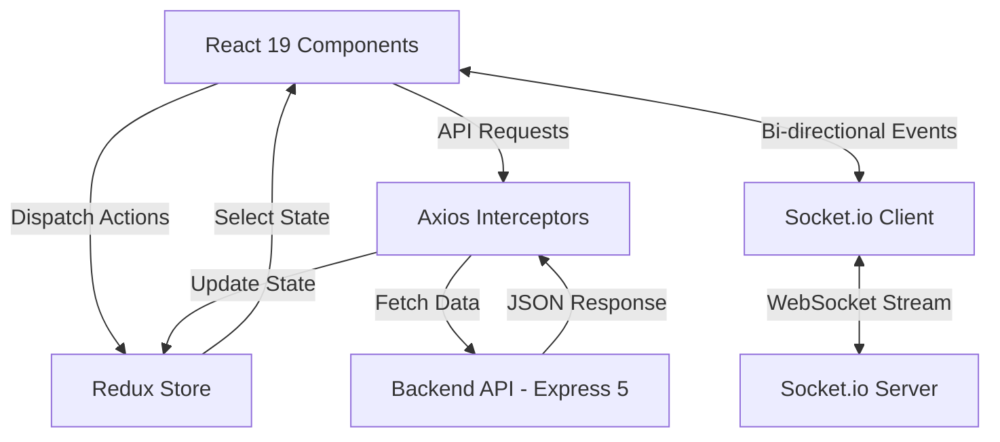

# SkillSync — Frontend Client

**A Modern Developer Networking & Real-Time Collaboration UI.**

  
  
  
  
  
  
  

---

## Executive Summary
The **SkillSync Frontend** is the client application for a developer matchmaking and networking platform (conceptualized as *"LinkedIn meets Tinder for Developers with an AI Copilot"*). 

Built with **React 19** and **Vite 7**, it delivers an interactive Single Page Application (SPA) featuring swipeable developer discovery, low-latency WebSocket messaging, and an in-chat Google Gemini AI assistant.

* **Backend Repository:** [https://github.com/ani1911/SkillSync](https://github.com/ani1911/SkillSync)

---

## Platform Workflow (4-Stage Collaboration Lifecycle)

SkillSync replaces shallow connections with an intentional 4-stage collaboration pipeline:

1. **Discover:** Browse developer profiles filtered by stack, with full keyboard support (`←` pass / `→` match).
2. **Mutual Match:** When two developers mutually like each other, they instantly unlock in the **Matches** hub.
3. **Connect with Pitch Note:** Send formal invites with personalized pitch notes (up to 300 chars); review and accept incoming invites in the **Network** inbox.
4. **Chat & @ai Copilot:** Collaborate via low-latency WebSockets and summon `@ai` for live debugging and architectural assistance directly inside chat.

---

## Client Architecture Flow

---

## Core Features & Implementation Details

### 1. Real-Time WebSocket Chat
- **Instant Messaging:** Built on `socket.io-client` with isolated rooms generated per match for zero-latency communication.
- **Auto-Anchoring:** Viewport automatically pins to incoming messages without jitter.
- **Connection-Gated Header:** Visually reflects match and connection status directly within the active chat view.

### 2. Google Gemini AI Copilot (`@ai`)
- **Native In-Chat Summoning:** Developers can type `@ai` in private chats to consult Gemini AI without leaving the conversation.
- **Syntax-Highlighted Markdown:** Uses `react-markdown` and `remark-gfm` to format code blocks, tables, and technical explanations.
- **Dedicated Bot Styling:** Custom accent themes and badges clearly distinguish AI assistance from human messages.

### 3. Matchmaking & Connections Hub
- **Discovery Card Deck:** Layered developer cards with perspective transforms and keyboard navigation (`←` pass / `→` match).
- **Dual Tab Network View:** Separate management for accepted developer connections and incoming pending invitations.
- **Pitch Note Previews:** Review personal messages sent with incoming connection invites before accepting or rejecting.
- **Interactive Features Walkthrough:** Accessible from the navigation bar to guide visitors through the collaboration lifecycle and system architecture.

### 4. Robust State Management (Redux Toolkit)
- **Centralized Store:** Slices manage authenticated user session (`userSlice`) and incoming invite notification counts (`requestsSlice`).
- **Live Badge Synchronization:** Pending invitation counts dynamically update the top navigation notification badge in real time.

### 5. Monetization & Razorpay Integration
- **In-App Payment Modal:** Connects with the backend Razorpay order API for one-click checkout.
- **Instant State Elevation:** Verifies payment and unlocks Pro badges and extended profile features without requiring page reloads.

---

*Built to demonstrate modern React 19 engineering, component-driven design, real-time WebSockets, and clean product UX.*
