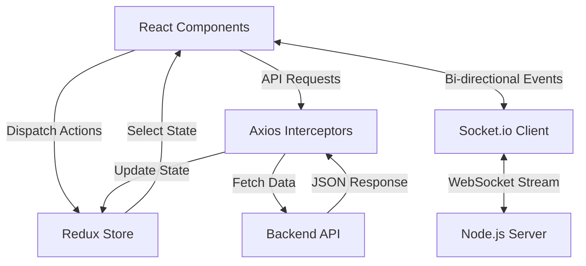

# SkillSync - Frontend Client

**A Premium, Dynamic UI for the Modern Developer.**

  
  
  

---

## Executive Summary
The **SkillSync Frontend** is a visually stunning, highly interactive single-page application (SPA) designed to wow users (and recruiters) at first glance. 
It leverages modern **Glassmorphism** design principles, sophisticated micro-animations, and a robust component architecture to deliver a seamless networking experience.

## Key Features & Engineering Highlights

### Client Architecture Flow

### 1. Premium UI/UX (Glassmorphism & Tailwind)
- **Dynamic Backgrounds:** Custom animated gradient blobs running in the background for a modern, fluid feel.
- **Glassmorphism:** Heavy use of `backdrop-blur`, semi-transparent borders, and layered shadows to create a deep, premium interface.
- **Responsive Design:** Flawlessly responsive across mobile, tablet, and ultra-wide displays using Tailwind utility classes.

### 2. Real-Time WebSocket Chat
- **Instant Connectivity:** Built on `socket.io-client` for zero-latency messaging.
- **Smart Auto-Scroll:** React `useRef` and `useEffect` implementations to intelligently pin the chat view to the newest incoming messages.
- **Premium Gating UI:** Context-aware rendering that visually locks or unlocks features (like GitHub links) based on the user's connection status.

### 3. AI Chat Integration & Markdown Parsing
- **Embedded Assistant:** Users can type `@ai` to seamlessly interact with Gemini AI natively in the chat.
- **Rich Formatting:** Utilizes `react-markdown` and `remark-gfm` combined with `@tailwindcss/typography` to beautifully render complex code snippets and data tables sent by the AI.

### 4. Robust State Management
- **Redux Toolkit:** Centralized store managing user sessions, incoming connection request counts, and theme preferences.
- **Custom Axios Instances:** Interceptor-driven API calls ensuring seamless JWT cookie transmission.

### 5. Advanced Matchmaking & Connections
- **Algorithmic Feed:** Users are presented with a dynamic feed of developers tailored to their tech stack.
- **Stateful Networking:** Complex UI state management for sending connection requests, handling incoming requests, and tracking bidirectional connection states (`ignored`, `interested`, `accepted`).
- **Interactive Match UI:** Visually distinct interfaces for pending requests versus accepted matches, powered by real-time data fetching.

---
*A showcase of modern frontend engineering, component-driven development, and obsessive attention to UI detail.*
